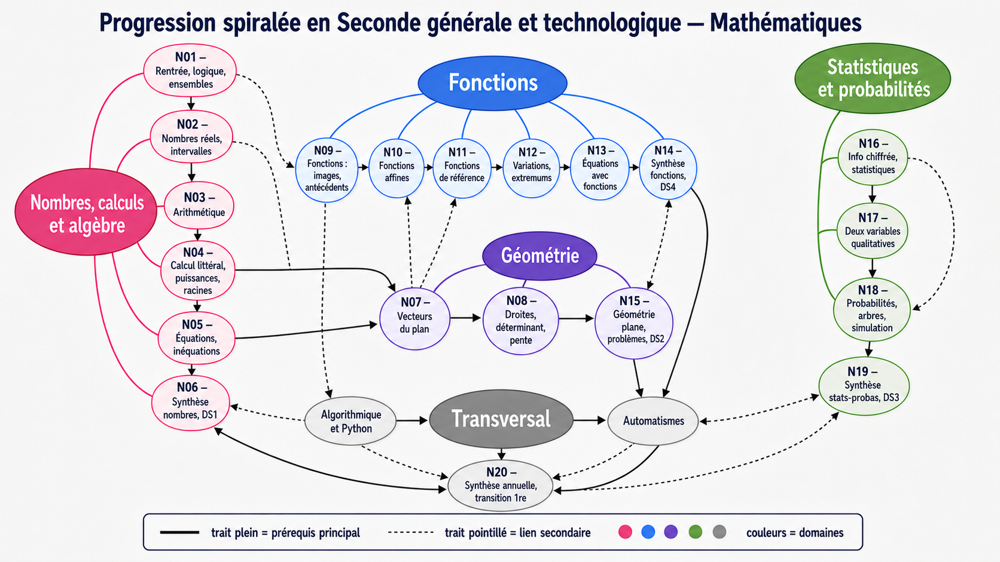

# Progression visuelle

La carte ci-dessous montre les notions de Seconde, regroupées par domaine, et les liens entre elles (prérequis en trait plein, liens secondaires en pointillé).

## Progression calendaire

[Ouvrir la progression calendaire (PDF)](assets/documents/Progression_calendrier.pdf)

## Carte de progression

**Cliquez sur une bulle pour ouvrir la page de la notion.**

<!-- CARTE-PROGRESSION:DEBUT -->

<button type="button" class="carte-fermer" aria-label="Fermer la carte agrandie">✕ Fermer</button>

[N01 – Rentrée, logique, ensembles](notions/N01-logique-ensembles.md){.bulle-progression style="left:14.47%;top:7.97%;width:9.03%;height:8.93%" title="N01 – Rentrée, logique, ensembles"}
[N02 – Nombres réels, intervalles](notions/N02-nombres-reels-intervalles.md){.bulle-progression style="left:15.13%;top:19.77%;width:8.01%;height:8.93%" title="N02 – Nombres réels, intervalles"}
[N03 – Arithmétique](notions/N03-arithmetique.md){.bulle-progression style="left:16.51%;top:32.41%;width:6.70%;height:8.08%" title="N03 – Arithmétique"}
[N04 – Calcul littéral, puissances, racines](notions/N04-calcul-litteral.md){.bulle-progression style="left:16.15%;top:43.04%;width:7.18%;height:10.20%" title="N04 – Calcul littéral, puissances, racines"}
[N05 – Équations, inéquations](notions/N05-equations-inequations.md){.bulle-progression style="left:15.91%;top:55.58%;width:7.48%;height:9.03%" title="N05 – Équations, inéquations"}
[N06 – Synthèse nombres, DS1](notions/N06-synthese-nombres-calculs.md){.bulle-progression style="left:15.25%;top:66.95%;width:7.54%;height:9.46%" title="N06 – Synthèse nombres, DS1"}
[N07 – Vecteurs du plan](notions/N07-vecteurs-du-plan.md){.bulle-progression style="left:38.04%;top:51.33%;width:6.82%;height:10.63%" title="N07 – Vecteurs du plan"}
[N08 – Droites, déterminant, pente](notions/N08-droites-equations.md){.bulle-progression style="left:48.39%;top:51.33%;width:7.30%;height:11.58%" title="N08 – Droites, déterminant, pente"}
[N09 – Fonctions : images, antécédents](notions/N09-fonctions-registres.md){.bulle-progression style="left:29.67%;top:24.65%;width:5.98%;height:11.05%" title="N09 – Fonctions : images, antécédents"}
[N10 – Fonctions affines](notions/N10-fonctions-affines.md){.bulle-progression style="left:36.96%;top:24.87%;width:5.32%;height:10.10%" title="N10 – Fonctions affines"}
[N11 – Fonctions de référence](notions/N11-fonctions-reference.md){.bulle-progression style="left:43.36%;top:24.87%;width:5.62%;height:10.20%" title="N11 – Fonctions de référence"}
[N12 – Variations, extremums](notions/N12-variations-extremums.md){.bulle-progression style="left:50.36%;top:24.87%;width:5.44%;height:10.10%" title="N12 – Variations, extremums"}
[N13 – Équations avec fonctions](notions/N13-equations-inequations-fonctions.md){.bulle-progression style="left:57.12%;top:24.76%;width:5.68%;height:10.63%" title="N13 – Équations avec fonctions"}
[N14 – Synthèse fonctions, DS4](notions/N14-synthese-fonctions-modelisation.md){.bulle-progression style="left:64.00%;top:24.87%;width:5.50%;height:10.41%" title="N14 – Synthèse fonctions, DS4"}
[N15 – Géométrie plane, problèmes, DS2](notions/N15-geometrie-plane-problemes.md){.bulle-progression style="left:59.57%;top:51.33%;width:7.60%;height:12.33%" title="N15 – Géométrie plane, problèmes, DS2"}
[N16 – Info chiffrée, statistiques](notions/N16-information-chiffree-statistiques.md){.bulle-progression style="left:83.91%;top:23.17%;width:6.70%;height:9.56%" title="N16 – Info chiffrée, statistiques"}
[N17 – Deux variables qualitatives](notions/N17-croisement-variables-qualitatives.md){.bulle-progression style="left:83.79%;top:36.24%;width:6.82%;height:9.46%" title="N17 – Deux variables qualitatives"}
[N18 – Probabilités, arbres, simulation](notions/N18-probabilites-echantillonnage.md){.bulle-progression style="left:83.43%;top:49.63%;width:7.48%;height:10.84%" title="N18 – Probabilités, arbres, simulation"}
[N19 – Synthèse stats-probas, DS3](notions/N19-synthese-statistiques-probabilites.md){.bulle-progression style="left:82.00%;top:63.66%;width:8.79%;height:9.99%" title="N19 – Synthèse stats-probas, DS3"}
[N20 – Synthèse annuelle, transition 1re](notions/N20-synthese-annuelle-transition-premiere.md){.bulle-progression style="left:44.92%;top:81.93%;width:10.23%;height:8.82%" title="N20 – Synthèse annuelle, transition 1re"}
[Automatismes](automatismes/index.md){.bulle-progression style="left:60.89%;top:70.78%;width:8.79%;height:8.18%" title="Automatismes"}

<button type="button" class="carte-agrandir md-button">Agrandir la carte (plein écran, bulles cliquables)</button>
<!-- CARTE-PROGRESSION:FIN -->
